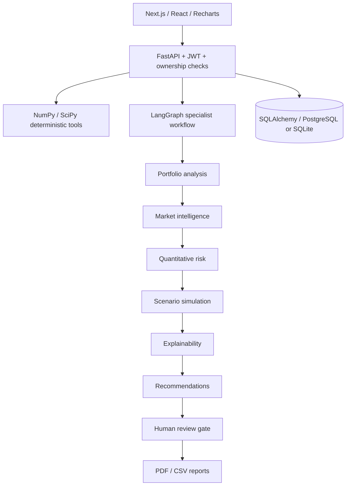

# AEGIS — Portfolio Risk Intelligence

**A Multi-Agent Framework for Explainable Investment Portfolio Risk Assessment and Scenario Simulation**

A runnable full-stack research application with a distinctive navy, teal, violet and amber interface. Deterministic financial tools calculate metrics; an eight-specialist LangGraph workflow organizes evidence; authorized reviewers make decisions. No trades are executed.

## Features

- Ten interactive workspaces: overview, portfolios, risk analytics, scenarios, agents, explainability, recommendations, reviews, reports, settings.
- Three seeded portfolios with twelve holdings each, four asset classes, and reproducible synthetic histories.
- Portfolio CRUD, holding editing, search, filtering, sorting, pagination, validated CSV import and export.
- Historical, normal-parametric and seeded Monte Carlo VaR; CVaR; volatility; drawdown; Sharpe; Sortino; beta; tracking error; correlations; Euler variance attribution.
- Seven scenario templates, adjustable shocks, saved outcomes, asset-level effects and comparison charts.
- LangGraph orchestration with typed state, retries, checkpointing during execution, persisted structured outputs and explicit human review routing.
- Evidence-linked explanations, deterministic question answering, illustrative counterfactual class allocations.
- Password hashing, JWT sessions, ownership checks, reviewer-only approval/rejection/revision with required comments and decision history.
- Downloadable PDF analytical reports and holdings, metrics and stress-comparison CSV files.
- PostgreSQL-compatible SQLAlchemy persistence; local SQLite fallback; Docker Compose and Vercel deployment configuration.

## Architecture



## Quick start

Requires Python 3.12+ and Node 20.9+.

```powershell
python -m pip install -r requirements.txt pytest httpx
Copy-Item .env.example .env.local
# Set environment variables for the Python process separately:
$env:JWT_SECRET = 'use-a-long-random-secret-for-your-installation'
python -m uvicorn backend.app.main:app --reload --port 8000
```

In a second terminal:

```powershell
npm ci
npm run dev
```

Open http://localhost:3000. Next reads BACKEND_URL from `.env.local`; Python reads its process environment. API documentation: http://localhost:8000/docs. Demo seed runs automatically on first startup. To reset local demo data, stop the backend and remove `aegis.db`, then restart.

## Demo credentials

| Role | Email | Password |
| --- | --- | --- |
| Analyst | analyst@aegis.demo | AegisDemo2026! |
| Reviewer | reviewer@aegis.demo | AegisReview2026! |

Production now requires sign-in and uses a secure HttpOnly SameSite session cookie. Sign in through the profile or Settings. Registration creates an analyst account; it cannot grant reviewer privileges. Demo review cases are shared with the demo reviewer. Do not upload sensitive data to the public demo.

## Configuration

| Variable | Purpose |
| --- | --- |
| DATABASE_URL | PostgreSQL SQLAlchemy URL; otherwise local SQLite (`/tmp` on Vercel) |
| JWT_SECRET | Stable random JWT signing secret, required for stable production sessions |
| DEMO_MODE | `true` seeds demonstration accounts and enables anonymous demo analyst access |
| CORS_ORIGINS | Comma-separated explicit frontend origins |
| BACKEND_URL | Next.js build-time reverse proxy target for a separately hosted API |

## Tests

```powershell
python -m pytest backend/tests -q
npm run build
npm run typecheck
```

Tests exercise deterministic calculations, accounting identities, shock arithmetic, validation, persistence, account isolation, the agent workflow, scenario saving, registration, reviewer authorization, human decisions, PDF/CSV output and counterfactual calculations. A production build performs TypeScript checks. Browser and deployment verification are documented in `docs/verification.md`.

## Financial methodology

All histories are **synthetic**. A seeded one-factor return model combines a shared market factor with independent residuals. Holdings are held at constant current weights. Annualization uses 252 trading days and arithmetic expected returns. Risk-free return is 4% annually. VaR/CVaR use a one-day horizon and nonnegative USD loss convention. Normal-model simulations are reproducible, not real financial predictions. Drawdown compounds daily returns from initial wealth 1. Composite risk score: 35% normalized volatility, 25% drawdown, 25% concentration HHI, 15% tail quantile, with disclosed caps. See the in-app methodology and [methodology documentation](docs/methodology.md).

## Deployment

**Combined Vercel:** `vercel --prod` from the repository root. Next.js renders the UI; rewrites route `/api/*` to the Python ASGI entry point `api/index.py`. Set JWT_SECRET and preferably DATABASE_URL in Vercel project environment variables. Keep BACKEND_URL unset for combined deployment. SQLite on Vercel is temporary, instance-local demo storage and can reset after a cold start; the UI discloses this. A managed PostgreSQL connection is necessary for durable, shared multi-user records.

**Separate API:** `render.yaml` prepares Render deployment. Set PostgreSQL DATABASE_URL, JWT_SECRET and CORS_ORIGINS. Set BACKEND_URL in Vercel and remove the combined Python rewrite from vercel.json when using that deployment topology.

**Docker:** Set POSTGRES_PASSWORD and JWT_SECRET, then `docker compose up --build`. PostgreSQL uses a named volume. Run `python -m alembic upgrade head` to record the versioned schema baseline. Destructive downgrades are disabled.

## Structure

```text
app/                     Next.js UI and design system
api/index.py             Vercel ASGI entry point
backend/app/main.py       FastAPI, SQLAlchemy, auth, graph, reports
backend/app/engine.py     Financial and scenario calculations
backend/tests/           Calculation and API workflow tests
docker/                  Frontend and backend Dockerfiles
docs/                    Methodology, API, setup and verification
```

## Database design and scope

Users are relational records. Portfolios, holdings snapshots, analyses, recommendations, review cases, audit events, report metadata, settings and scenarios are stored as typed JSON records with indexed ownership, portfolio association and timestamps. This compact implementation does **not** implement the brief's fifteen fully normalized tables or Alembic schema history. Holdings are embedded in portfolio records; synthetic return matrices are reproduced from seeds instead of storing price rows. Audit records are application append-only; the database owner can alter them.

## Limitations and future work

This is a functioning educational research release, not an independently validated enterprise production system. It does not connect live prices or a paid LLM, implement SHAP, job queues, durable graph checkpoints, password recovery, private tenant administration, or transactional portfolio trading. A constrained long-only optimizer uses SciPy SLSQP with position/sector caps, optional target returns, risk aversion and turnover costs. Explanations are rule-based and allocation alternatives are explicit class-weight illustrations. The eight-agent workflow pauses at human review; draft reports can still be exported with unapproved status. Decisions are persisted, while graph resumption after approval is not implemented. SQLite serverless persistence and process-local demo JWT secrets must be replaced with configured PostgreSQL and JWT_SECRET for shared durable production use.

Future work: normalized migrations, verified market adapters, optional grounded LLM adapter, constrained optimization, durable asynchronous runs, automated browser coverage, and independent security/quantitative review.

## Screenshots

The dashboard presents portfolio performance, allocation, a composite risk gauge, covariance attribution, agent readiness and scenario templates. Open the deployed URL or run locally to inspect the responsive interface. No screenshot or test result is claimed unless recorded in `docs/verification.md`.

## Production storage and authentication update

Neon PostgreSQL (free plan, iad1) is connected to the Vercel production environment through DATABASE_URL. REQUIRE_AUTH=true enforces sign-in on protected APIs. JWT_SECRET is configured in Vercel. Passwords use Argon2; browser sessions use HttpOnly, Secure-on-Vercel, SameSite=Strict cookies. Logout clears the cookie. Shared demo portfolios are read-only for other accounts. The left navigation scrolls independently on short screens.

Run schema migration: `python -m alembic upgrade head`. Optimization API: `POST /api/portfolios/{id}/optimize`. The Recommendations page exposes asset caps, sector caps, transaction costs, proposed weights and calculated alternative volatility. All outputs remain pending human review.

Vercel GitHub integration remains blocked by GitHub App repository permissions. CLI deployments work; automatic pushes require granting the Vercel GitHub App access to this repository and running `vercel git connect --yes`.
